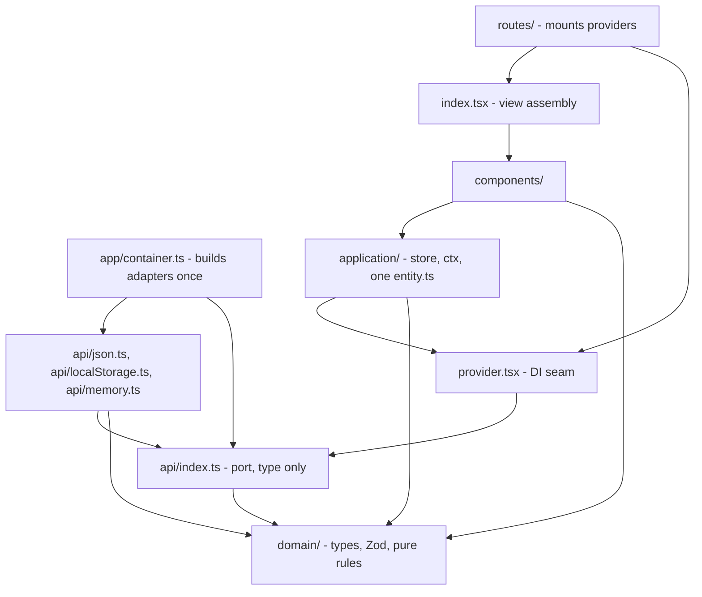
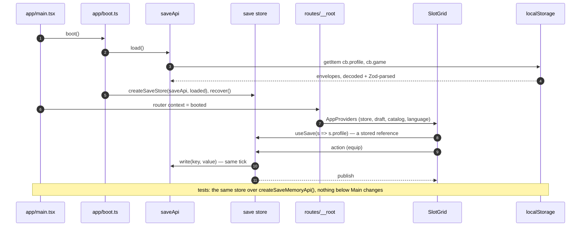
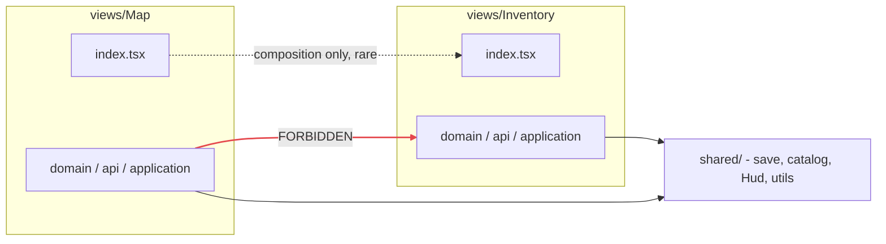

# Couple Battle — Frontend Architecture (LAW)

> This document is the **architecture contract** for the codebase. The generic document below
> (from Luca, verbatim, starting at "# Frontend architecture") defines the structure; this preamble
> pins the stack and maps the generic examples onto Couple Battle. When in doubt, this file wins
> over convenience. It is deliberately more architecture than an MVP needs — that is intentional:
> when a server is added later, only adapters and the container change.

## Pinned stack

| Piece | Choice | Notes |
|---|---|---|
| React | **React 19** — https://react.dev/blog/2024/12/05/react-19 | `useEffectEvent` is the only sanctioned "stabilize a callback" tool (conventions below) |
| Language | TypeScript, strict | `tsc --noEmit` must pass at every commit |
| Build | Vite | |
| Router | **@tanstack/react-router** — https://tanstack.com/router | **Use `createHashHistory()`** — GitHub Pages has no SPA rewrites. Router context carries the DI container exactly as the doc below shows. Pin the installed version and consult its docs for current APIs — do not write route code from memory |
| Save state | **Boot-hydrated save store** (`useSyncExternalStore`) | Loaded once before the first render; synchronous write-through (write, then publish, same tick). No TanStack Query: no network, nothing to invalidate. Add Query only with remote data |
| Validation | **Zod** | Parse at every adapter boundary |
| PWA | **vite-plugin-pwa** — https://vite-pwa-org.netlify.app/guide/ | `registerType: 'autoUpdate'`, precache everything: the game must be fully playable offline after first load |
| Storage | **`localStorage`** (synchronous, values of a few KB) | Used only inside `shared/save/api/localStorage.ts`. The pre-refactor IndexedDB save is imported once by `shared/save/api/idbImport.ts` (raw `indexedDB`, no library) then deleted. Lint bans both globals everywhere else |
| i18n | **No library — typed dictionaries + a ~30-line hook** (decision) | `src/data/strings.fr.ts` / `strings.en.ts` / `strings.es.ts` export `as const` objects; `shared/i18n` exposes `useT(): (key: TStringKey, vars?: Record<string, string \| number>) => string` with `TStringKey = keyof typeof fr` and `{name}`-style interpolation. `LangProvider` is controlled by `settings.lang` from the save store (one owner, no mirror). Wrong keys are compile errors — with 3 locales and ~236 flat keys this beats react-i18next. FR is the fallback language |
| Testing | Vitest + React Testing Library | The real save store over the memory adapter (strings, like `localStorage`) — never mock storage; `expectSynced` after every action (doc below) |

## Mapping the generic doc onto Couple Battle

The doc below uses an RPG inventory as its running example. Translate as follows:

| Generic example | Couple Battle equivalent |
|---|---|
| `shared/catalog` (items.json) | `shared/questions` — bundled `questions.fr.json` / `questions.en.json` / `questions.es.json`; synchronous port `TQuestionsApi { list(filter: TQuestionFilter): TQuestion[] }`; adapter `json.ts` Zod-parses a language on first use, once |
| `shared/save` (IndexedDB) | `shared/save` — two `localStorage` keys, each a `{ v, savedAt, data }` envelope: `cb.profile` (`{ settings, seenIds, guidelinesSeen, soloBest }`) and `cb.game` (the running `TGame`); `cb.profile.bad` keeps the first unreadable profile. One synchronous `TSaveApi` port (`load` / `write` / `remove`), one save store (`application/store.ts`) |
| `views/Inventory` etc. | `views/Home`, `views/Setup`, `views/Mode`, `views/Difficulty`, `views/Settings`, `views/HowToPlay`, `views/Legal`, `views/Play` |
| domain services (`canEquip`) | `drawDeck`, `reduce(machine, event)`, `applyScore`, `rankTeams`, … — the game reducer lives in `views/Play/domain/` and is **always tested** |
| `Hud` | `shared/Chrome` — `PixelButton`, `PixelPanel`, `Sprite`, `ProgressDots`, `PauseButton`, … styled from `handoff/design/tokens.css` |

**The one sanctioned deviation from "1 route = 1 view":** the flow inside a game (pass-phone →
secret answers → reveal → judge → countdown → resolve → …) is a **state machine in
`views/Play/domain/machine.ts`** (pure reducer over `TGame = { ctx, step }`, whose Zod shape lives
in `shared/game/domain/game.ts` so the save can validate it), NOT nested routes —
a URL change must never be able to skip a secret screen or replay a judged question
(handoff/docs/views-spec.md §1 "Routing model"). The in-game screens live in `views/Play/components/`
(one folder per V-* id). Hardware/browser back inside `#/play` opens the pause sheet.
Everything else follows the doc below to the letter.

**Ports are data only:** `app/container.ts` builds `questionsApi` and `saveApi`, nothing else.
**Sound** and the **wake lock** are UI output, not ports: no provider, not in the container.
`shared/sound` exports `useSound()` (one Web Audio engine for the app — the synth from
`handoff/lib/sounds.js` plus the music files — silent where there is no `AudioContext`, so tests
need no stub; the shell drives it from `settings.sound`); `shared/wakeLock` exports `useKeepAwake()`
(used by Play).

## Data safety (non-negotiable)

- Every stored value is `{ v, savedAt, data }`; `MIGRATIONS` upgrade an older `v`; a newer `v` →
  memory mode (status `memory`, banner "Saving is off this session"), never overwrite it.
- A profile that fails to decode is copied to `cb.profile.bad` (never overwritten, never deleted)
  before anything can write `cb.profile`, and the player is told. Profile fields parse one by one
  (`.catch(default)`): one bad field or id never wipes the rest.
- One writer: only the save store calls the save port, and only the save adapters touch storage
  (lint). Each action writes synchronously, **then** publishes: what the player sees is what a
  relaunch reloads. A failed write marks the key dirty (banner + Retry), retried on the next
  action and when the page is hidden.
- An invalid or inconsistent game is discarded with a notice, never restarted silently; a game
  older than 12 h is dropped (it holds Flash secrets).
- The reducer is the rule book: an illegal or stale-`seq` event returns the same state (no
  render, no write).
- Finish = write the final game → merge the profile (idempotent: seen ids ∪ deck, solo best =
  max) → remove the game; boot replays a pending final first.
- Text input goes through `normalizeText` (NFC, strip zero-width + bidi controls, trim, max length).
- The root and `/play` routes have an `errorComponent`; a failed boot renders a provider-free
  crash screen. Saved data is never touched by an error path.

---

# Frontend architecture — game (views + local storage)

Hexagonal / Clean Architecture for a **client-only game**. Stack: **React**, a **boot-hydrated save store** (`useSyncExternalStore`, not a cache), **TanStack Router**, **Zod**.

Code is sliced **by view**, not by layer. Each view is a full vertical (`domain` → `api` → `application` → `components`). `shared/` holds views, entities, and utils used by 2+ screens.

There is **no HTTP**. The `api/` layer still exists: it is a **port**. Implementations talk to a **JSON catalog** (static game data) or **`localStorage`** (player save). Both ports are synchronous. Swap them at the DI boundary.

Running example: `views/Inventory/` + shared `catalog` (JSON) + shared `save` (`localStorage`).

---

## Mental model

A diagram lies when one arrow means two things. These are split: this one is **static — who may import whom**. The runtime call order is a separate diagram in the DI section below.



Every arrow means **imports**, nothing else. The payoff is what is missing: no path from `components/` or `application/` down to an adapter. The only module that names a concrete backend is `app/container.ts`.

- **Domain** — entities + rules (`canEquip`, `stackInto`). No React, no storage.
- **API (port)** — `api/index.ts` exports only the async contract type. **Not** `fetch`.
- **Adapters** — `json.ts`, `localStorage.ts`, `memory.ts`. Same port type, different backend. Zod parses at this boundary.
- **Provider** — holds an instance typed as the port. Knows no backend.
- **Application** — the save store (`store.ts` + `ctx.tsx`, in `shared/save`), at most one `<entity>.ts` per view wrapping it with the view's domain (Play: `game.ts`), optional UI context. Never `create*`s an adapter.
- **Components** — render. Application hooks + domain services only.
- **Composition** — `app/container.ts` builds adapters once; `app/boot.ts` loads the save into the store before the first render; `routes/__root.tsx` mounts the one provider stack; routes add guards.

---

## Dependency injection (the point of the architecture)

UI must not know *where* a sword comes from. Tests must not touch real storage. The catalog always comes from JSON; the save comes from `localStorage`, or from memory (tests, a session where storage is off).

### Port vs adapters

```ts
// api/index.ts — PORT (type only lives here for consumers). Synchronous: the store writes in
// the same tick as it updates memory.
export type TSaveApi = {
  load(): TLoaded;                                   // once, at boot: decoded profile + game + issues
  write<K extends TSaveKey>(key: K, value: TSaveValues[K]): void; // throws when storage refuses
  remove(key: TSaveKey): void;
};
```

```ts
// api/localStorage.ts — ADAPTER
export function createSaveLocalStorageApi(storage = () => window.localStorage): TSaveApi { /* … */ }

// api/json.ts — ADAPTER (static catalog, read-only)
export function createCatalogJsonApi(data: unknown): TCatalogApi { /* … */ }

// api/memory.ts — ADAPTER (tests, storage off): the same adapter over a Map of STRINGS
export function createSaveMemoryApi(storage = createMemoryStorage()): TSaveApi { /* … */ }
```

### One composition root, built once

Build every adapter **once** in `app/container.ts`. The container **only builds**: it reads nothing and writes nothing. Loading is `boot()`'s job.

```ts
// app/container.ts — the only module that names a backend
export type TContainer = {
  catalogApi: TCatalogApi;
  saveApi: TSaveApi;
};

export function createContainer(mode: 'persistent' | 'memory' = 'persistent'): TContainer {
  return {
    catalogApi: createCatalogJsonApi(),
    saveApi: mode === 'memory' ? createSaveMemoryApi() : createSaveLocalStorageApi(),
  };
}
```

```tsx
// app/boot.ts + app/main.tsx
const booted = await boot();      // one-time import → saveApi.load() → createSaveStore() → recover()
const router = createRouter({ routeTree, context: booted }); // guards read booted.store / booted.draft
// bootstrap() wraps both in try/catch → a provider-free crash screen
```

Three rules that make DI real:

1. **`provider.tsx` depends on the port type**, never on `localStorage.ts` / `json.ts`.
2. **Only the save store calls the save port.** Screens read with `useSave(selector)` and change data through store actions.
3. **`app/` (container + boot) is the only place that picks a backend.** `routes/__root.tsx` mounts the providers once with what the router context holds.

### Runtime flow

Same story, now as call order — construction, boot, read, write.



Add a file-backed save later: one new factory, one line in the container. No view changes.

**Tests:** boot the real store over the memory adapter (`src/test/renderApp.tsx`, `src/test/expectSynced.ts`) and wrap with `TestProviders`. Never mock storage.

---

## Folder structure

`views/` and `shared/` are both divided **by view / entity**. Same internal layers. `shared/` also holds cross-cutting `utils/`.

```tree
src/
├── app/
│   ├── container.ts                      # builds every adapter once — only place naming a backend
│   ├── boot.ts                           # load the save → store → recover(), before the first render
│   ├── Shell.tsx                         # the one provider stack + app-wide UI (save notices)
│   └── main.tsx                          # boot() -> createRouter({ context }); crash screen on failure
│
├── views/
│   └── Inventory/                        # PascalCase screen
│       ├── domain/
│       │   ├── types.ts                  # T* + Z*Schema
│       │   ├── services.ts               # canEquip, stackItems
│       │   └── services.test.ts          # always
│       ├── api/
│       │   ├── index.ts                  # TInventoryApi port (+ optional factory types)
│       │   ├── json.ts                   # catalog-backed reads (if exclusive)
│       │   └── memory.ts                 # tests
│       ├── application/
│       │   ├── ctx.tsx                   # optional UI ctx (selected slot)
│       │   └── inventory.ts              # at most one: the save store + this view's domain
│       ├── components/
│       │   ├── SlotGrid/
│       │   │   ├── index.tsx
│       │   │   └── useSlotGridState.ts
│       │   └── EquipButton.tsx
│       ├── views/                        # nested screens = nested routes
│       │   └── Inspect/                  # URL: inventory/$itemId
│       │       ├── application/
│       │       ├── components/
│       │       └── index.tsx
│       ├── provider.tsx                  # DI: Provider + useInventoryApi()
│       ├── index.tsx                     # view assembly + public re-exports
│       └── view.md                       # why, not how
│
├── shared/                               # 2+ views, or game-wide utils
│   ├── catalog/                          # static JSON bestiary / items
│   │   ├── domain/
│   │   ├── api/
│   │   │   ├── index.ts                  # TCatalogApi
│   │   │   └── json.ts                   # parse bundled items.json
│   │   ├── application/
│   │   ├── provider.tsx
│   │   └── index.ts
│   ├── save/                             # player persist — the one owner of saved data
│   │   ├── domain/                       # schemas, codec (envelope, MIGRATIONS), mergeFinish
│   │   ├── api/
│   │   │   ├── index.ts                  # TSaveApi (sync: load / write / remove)
│   │   │   ├── localStorage.ts
│   │   │   ├── idbImport.ts              # one-time move of the pre-refactor IndexedDB save
│   │   │   └── memory.ts
│   │   └── application/
│   │       ├── store.ts                  # createSaveStore: write, then publish
│   │       └── ctx.tsx                   # SaveStoreProvider, useSaveStore, useSave(selector)
│   ├── Hud/                              # shared view chrome
│   └── utils/
│       └── react/
│
└── routes/
    ├── __root.tsx                        # createRootRouteWithContext<TBooted>(): providers once + errorComponent
    ├── map.tsx
    └── inventory.tsx                     # beforeLoad guard → redirect; renders the view
```

### Naming

| Thing | Case | Example |
|---|---|---|
| View / nested view / component folder | PascalCase | `views/Inventory/`, `views/Inspect/`, `components/SlotGrid/` |
| Layer folders | camelCase | `domain/`, `api/`, `application/`, `components/` |
| Fast-context files | lowercase | `application/ctx/selection.tsx` |
| Domain types | `T` prefix | `TItem`, `TSaveApi` |
| Zod schemas | `Z` + `Schema` | `ZItemSchema` |
| State updaters | `make*` if curried, bare verb if `(state) => next` | `makeSelectSlot`, `clearSelection` |
| Adapter factories | `create[Name][Backend]Api` | `createSaveLocalStorageApi`, `createCatalogJsonApi` |

### Folder rules

- Folder only when 2+ related files. Single files stay flat.
- Component folder only when it has a UI hook or private sub-components. No nested `components/` — private pieces are flat files in the parent folder.
- Tests sit next to what they test. Never `__tests__/`.
- **1 route = 1 view. 1 subroute = 1 nested view.** Nested views render on their own route; they are not embedded in the parent screen.

---

## Layers, with examples

### `domain/types.ts` — entities, not props

```ts
import { z } from 'zod';

export const ItemKind = {
  Weapon: 'weapon',
  Armor: 'armor',
  Consumable: 'consumable',
} as const;
export type TItemKind = typeof ItemKind[keyof typeof ItemKind];

export const ZItemSchema = z.object({
  id: z.string(),
  name: z.string().min(1),
  kind: z.enum(['weapon', 'armor', 'consumable']),
  slot: z.enum(['head', 'body', 'hand', 'none']),
  stackMax: z.number().int().positive(),
});
export type TItem = z.infer<typeof ZItemSchema>;

export const ZInventorySchema = z.object({
  slots: z.array(z.object({
    itemId: z.string(),
    qty: z.number().int().positive(),
  })),
});
export type TInventory = z.infer<typeof ZInventorySchema>;
```

Prop types stay in the component file.

### `domain/services.ts` — pure game rules

No async, no storage, no React. Always tested.

```ts
import type { TInventory, TItem } from './types';

export function canEquip(item: TItem, occupied: Set<string>) {
  if (item.slot === 'none') return false;
  return !occupied.has(item.slot);
}

export function stackInto(inventory: TInventory, itemId: string, qty: number): TInventory {
  // …pure, returns a new inventory
}
```

Would this make sense without a screen (combat sim, CLI)? → domain. Exists only because of a widget? → `components/<Name>/useX.ts`.

### `api/` — port + local adapters (no server)

The **port** is the contract. **JSON** = bundled catalog. **`localStorage`** = player save. **Memory** = tests / a session where storage is off. Both ports are synchronous: the data is local, so there is nothing to await.

Zod parse happens in every adapter as data crosses the boundary.

```ts
// shared/catalog/api/index.ts
export type TCatalogApi = {
  listItems(filter?: { kind: TItemKind }): TItem[];
};

// shared/catalog/api/json.ts
import itemsJson from '../data/items.json';

export function createCatalogJsonApi(raw: unknown = itemsJson): TCatalogApi {
  let items: TItem[] | undefined; // parsed on first use, once
  return {
    listItems(filter) {
      items ??= z.array(ZItemSchema).parse(raw);
      return filter ? items.filter((item) => item.kind === filter.kind) : items;
    },
  };
}
```

```ts
// shared/save/api/localStorage.ts — one envelope per key: { v, savedAt, data }
export function createSaveLocalStorageApi(storage = () => window.localStorage): TSaveApi {
  return {
    load() {
      const profile = decode('profile', storage().getItem('cb.profile')); // migrate → Zod
      // invalid → copy the raw string to cb.profile.bad FIRST, defaults, issue 'profileReset'
      // newer  → defaults in memory, persistent: false (never overwrite a newer save)
      /* … same for cb.game … */
    },
    write(key, value) {
      storage().setItem(STORAGE_KEYS[key], encode(key, value, Date.now()));
    },
    remove(key) {
      storage().removeItem(STORAGE_KEYS[key]);
    },
  };
}

// shared/save/api/memory.ts — the same adapter over a Map of strings: a value that cannot
// survive JSON fails in tests exactly as it would in the browser
export function createSaveMemoryApi(storage = createMemoryStorage()): TSaveApi {
  return createSaveLocalStorageApi(() => storage);
}
```

Method shape (storage instead of HTTP):

```ts
getById(id: string)
list(filter: TItemFilter, options?: { limit: number })
write(key: TSaveKey, value: TSaveValues[K])
```

Group args by theme (identity / payload / options) when there are more than two. One identifier stays positional.

**Never** `import items.json` from `application/` or `components/`. The JSON file is an adapter input, wired in `app/container.ts`.

### `provider.tsx` — DI seam

Depends on the **port type**, never on a backend. Only data ports have one (the catalog);
the save port is held by the save store, which has its own provider.

```tsx
import { createContext, useContext, type FC, type PropsWithChildren } from 'react';
import type { TCatalogApi } from './api';

const CatalogApiCtx = createContext<TCatalogApi | null>(null);

export const CatalogApiProvider: FC<PropsWithChildren<{ api: TCatalogApi }>> = ({
  api,
  children,
}) => <CatalogApiCtx.Provider value={api}>{children}</CatalogApiCtx.Provider>;

export function useCatalogApi(): TCatalogApi {
  const ctx = useContext(CatalogApiCtx);
  if (!ctx) throw new Error('CatalogApiProvider not found in tree');
  return ctx;
}
```

### `application/store.ts` + `ctx.tsx` — the save store

Persisted data is read once at boot into one store (`shared/save/application/store.ts`). Components read slices with `useSave(selector)` and change them through store actions. Each action writes storage synchronously, **then** publishes the new state; a failed write marks the key dirty (retried on the next action, when the page is hidden, or from the banner's Retry), sets `status: 'failing'` and never throws into render.

```ts
// shared/save/application/ctx.tsx
export function useSave<T>(selector: (state: TSaveState) => T): T {
  const store = useSaveStore();
  return useSyncExternalStore(store.subscribe, () => selector(store.get()));
}
export const selectSettings = (s: TSaveState) => s.profile.settings; // a STORED reference, never a new object
```

```ts
// in a component
const settings = useSave(selectSettings);
const store = useSaveStore();
const handleMute = () => store.updateSettings({ sound: false }); // written, then shown
```

A view wraps the store with its own domain in **at most one** `application/<entity>.ts` (Play: `game.ts` — `useGame()` reduces an event with the rendered `seq`, `store.updateGame`, and on the transition to `final` `store.finishGame`). It is the only code of that view touching save. Data read from the store is never copied into `useState`.

**Forbidden:** any other standalone `application/use*.ts`. UI glue → `components/<Name>/useX.ts`. Shared client UI state → `ctx`. Persistence → store actions.

### `application/ctx.tsx` vs `ctx/*.tsx`

| When | Where |
|---|---|
| Small shared UI state (selected slot, pause menu open) | `ctx.tsx` |
| Normalised store + selectors, hot updates (many HUD subscribers) | `ctx/*.tsx` + `domain/services/<slice>/` |
| One widget | local state / `useMyComponentState.ts` |
| Save data | the save store (`useSave`) — never copied into `useState` |
| Bundled catalog | `use[Catalog]Api().list…()`: a sync port, parsed once per language |

### `index.tsx` — view + public surface

1. Assemble the screen the route renders.
2. Re-export types, hooks, provider — the **only** composition surface.

```tsx
import { type FC } from 'react';
import { SlotGrid } from './components/SlotGrid';
import { EquipButton } from './components/EquipButton';

export const InventoryView: FC = () => (
  <div>
    <SlotGrid />
    <EquipButton />
  </div>
);

export type { TInventory } from './domain/types';
export { useInventory } from './application/inventory';
```

Nested-view `index.tsx` only assembles a screen — no public re-exports.

### `view.md`

Non-obvious decisions only: why catalog is `shared/` not inside Inventory, why an action writes before it publishes, why Inspect is a nested view.

### Route = guard + view; the root mounts the providers once

The router context is the booted app (`TBooted = { container, store, draft }`). `routes/__root.tsx` mounts the one provider stack (save store, draft, catalog, language) and the app shell. A route names its **guard** and its view, never a backend.

```tsx
// routes/__root.tsx
export const Route = createRootRouteWithContext<TBooted>()({
  component: RootLayout,       // <AppProviders {...context}><Shell><Outlet /></Shell></AppProviders>
  errorComponent: CrashScreen, // renders outside the providers: provider-free by design
});
```

```tsx
// routes/inventory.tsx
export const Route = createFileRoute('/inventory')({
  beforeLoad: ({ context }) => {
    if (!context.draft.get().roster) throw redirect({ to: '/setup', replace: true });
  },
  component: InventoryView,
});
```

A guard reads the store synchronously (it is hydrated before the router exists); nothing loads per navigation.

New game / tests / Storybook: `boot(createContainer('memory'))`. `InventoryView` does not change.

---

## Import boundaries

### View slice

Every `views/<Name>/` (and every `shared/<Name>/` entity) is a full vertical. Nested views under `views/<Parent>/views/<Child>/` follow the same rule when the code is exclusive to that subroute.

### Cross-view = `shared/` (hard rule)

`views/Map` must **not** import `views/Inventory/domain`, `views/Inventory/api`, or `views/Inventory/application` — including type-only imports.

Shared HUD, catalog, save, utils → `shared/`. Composition of another **screen** (rare) goes through that view's `index.tsx`.

| Layer | May import |
|---|---|
| `app/` (`container.ts`, `boot.ts`) | every `api/*.ts` **adapter factory** — the only modules allowed to |
| `routes/` | view `index.tsx`, `provider.tsx`, `shared/*/index.tsx`, `app/` (the shell, the context type) — takes everything from context, never constructs it |
| `components/` | `application/`, `domain/services`, `shared/*/index.tsx` |
| `application/` | `domain/types`, `domain/services`, `provider` (`use[View]Api()`), `shared/*/index.tsx` (the save store: `useSave`, `useSaveStore`) |
| `provider.tsx` | `api/` **type** only, optionally `application/ctx` |
| `domain/` | `shared/*/domain/` only — no React, no storage, no JSON imports |
| `api/` adapters | `domain/types` only |
| nested view | anything in the **parent** (by path); never sibling views |



### Golden rules

1. Domain imports nothing outside `shared/*/domain/`.
2. `api/` implements domain types, never the reverse. Adapters (JSON / localStorage / memory) are imported by **`app/` (container, boot) only**.
3. Application hooks never instantiate an adapter — they `use[View]Api()` or use the save store.
4. `provider.tsx` is the DI seam (port type in, instance from above).
5. Components never import `api/` — only `application/` and `domain/services`.
6. Cross-view composition via `index.tsx`. Shared contracts via `shared/`.
7. **`app/container.ts` builds; `app/boot.ts` loads; `routes/__root.tsx` mounts.** Nothing else wires.
8. Nested views are full views. They may import parent internals. They never import siblings.
9. `index.tsx` assembles the screen **and** re-exports. The route guards and renders it. Those stay separate.
10. No sibling view internals. Escape hatch: `shared/<Entity>/` or `shared/utils/`.

---

## Nested views and locality

Keep code as close as possible to the view that needs it. Promote only when shared.

| Situation | Where it lives |
|---|---|
| Used only by this nested view | inside it |
| Used by a sibling or the parent | promote to the parent |
| Nested view reads parent-owned save/catalog | import the parent's query keys — don't redeclare |
| Nested view needs parent internals | import by path |
| Parent needs a nested view | only `views/*/index.tsx`, and only when embedding (rare) |

```tree
views/Map/
├── views/
│   ├── Encounter/      # route: /map/encounter
│   └── Travel/         # route: /map/travel
└── index.tsx
```

---

## Placement cheat sheet

| You have… | It goes in… |
|---|---|
| Entity type or Zod schema | `domain/types.ts` |
| Pure rule (`canEquip`) | `domain/services.ts` |
| Storage contract (port) | `api/index.ts` |
| Bundled `items.json` reader | `api/json.ts` |
| Player-save persist | `shared/save/api/localStorage.ts` (only the save store calls it) |
| In-memory / test / new-game | `api/memory.ts` |
| Simple shared UI state | `application/ctx.tsx` |
| Normalised UI store + selectors | `application/ctx/*.tsx` + `domain/services/<slice>/` |
| Read saved data | `useSave(selector)` (stored references) |
| Change saved data | a save store action (`shared/save/application/store.ts`) |
| A view's game/entity logic over the store | one `application/<entity>.ts` (Play: `game.ts`) |
| Local widget state | `components/MyComponent/useMyComponentState.ts` or inline |
| UI glue for one area | `components/<Name>/useX.ts` |
| Hook shared across component folders, not ctx-worthy | `utils/useX.ts` at view root |
| Standalone `application/use*.ts` | **forbidden** |
| React component | `components/` |
| Prop type | inside the component file |
| Entity / chrome / util used by 2+ views | `shared/[name]/` |
| Screen assembly | view-root `index.tsx` |
| Nested screen | `views/<Name>/` inside the parent |
| Non-obvious decision | `view.md` |

---

## Testing

| What | Test | Required? |
|---|---|---|
| domain services / slice `actions.ts` | co-located `*.test.ts` | **always** |
| selectors | `selectors.test.ts` | when non-trivial |
| save store, codec (decode, migrations), adapters | `*.test.ts` with the memory adapter, `expectSynced` after every action | **always** |
| folder component | `[Name].test.tsx` | when branching / interactions |
| nested-view component | `[Name].test.tsx` | **always** |
| `ctx`, `provider` | — | covered via hook/component tests |
| route guards, error screens | `*.test.ts(x)` | **always** |

| Layer | Wrap with |
|---|---|
| domain | nothing |
| save store | `createSaveStore(createSaveMemoryApi(storage), …)` — or `bootTestSave(seed)` (`src/test/expectSynced.ts`) |
| component reading the store | `TestProviders` / `renderWithApp` (`src/test/renderApp.tsx`): the real store over memory storage |

Swap `createSaveMemoryApi` / `createCatalogJsonApi(fixture)` at the boot. Do not mock storage: the memory adapter stores strings like `localStorage`. After **every** action in store, Play and Settings tests, `expectSynced(store, api)` checks that what storage holds decodes to exactly what the store shows.

---

## TypeScript conventions

**Type imports last, with `type`:**

```ts
import { useState, type FC, type ReactNode } from 'react';
import { type TSaveApi } from './api';
```

**`type` over `interface`.** Interface only for declaration merging (comment why).

**No enums** — `as const` objects or string unions.

**Group function args by theme.** React props stay one object. One-id helpers stay positional.

**JSDoc** on functions that are not obvious one-liners.

---

## React conventions

Components: `const Name: FC<Props> = (props) => …`. Generics drop `FC`, stay arrows.

Explicit variants over boolean soup. Compound components + `children` for structure.

### No `useCallback`

Do not wrap handlers in `useCallback`. Let the function be recreated. If an **effect** must call the latest handler without re-subscribing, use **`useEffectEvent`** — that is the only "stabilize this callback" tool. Do not introduce `useCallback` to feed an effect dependency array.

```tsx
// forbidden
const handleEquip = useCallback(() => { /* … */ }, [itemId]);

// default — named handler, new each render is fine
const handleEquip = () => {
  store.equip(itemId);
};

// last resort — effect needs latest handler, subscription stays stable
const onKey = useEffectEvent((e: KeyboardEvent) => {
  if (e.key === 'e') store.equip(itemId);
});
useEffect(() => {
  window.addEventListener('keydown', onKey);
  return () => window.removeEventListener('keydown', onKey);
}, []);
```

### `useEffect` — avoid, then use when it is actually an external system

Prefer: derive during render, event handlers, the save store, `key` to reset.

| Instead of effect for… | Use |
|---|---|
| Loading catalog / save | boot hydration (`boot()` before the first render); the catalog port is synchronous |
| Computed values | derive / domain service |
| Click / submit / drag | named event handler / store action |
| Reset on prop change | `key` prop |

**Legitimate effects** (external systems): `requestAnimationFrame` game loop, keyboard/pointer capture, page `visibilitychange` / `pagehide` (re-send dirty saves), Howler/WebAudio, canvas resize observer.

```tsx
// wrong — derived state
useEffect(() => { setLabel(`${item.name} ×${qty}`); }, [item, qty]);

// right
const label = `${item.name} ×${qty}`;
```

```tsx
// right — game loop is an external clock
useEffect(() => {
  let frame = 0;
  const tick = (t: number) => {
    loopRef.current?.(t);
    frame = requestAnimationFrame(tick);
  };
  frame = requestAnimationFrame(tick);
  return () => cancelAnimationFrame(frame);
}, []);
```

### No anonymous functions for **event handlers** in JSX

Extract a child that closes over the id, or a `makeEquipHandler(id)` factory.

**Render props may be anonymous.** Returning JSX is composition, not an action.

```tsx
// forbidden — action callback
<button onClick={() => equip(item.id)}>Equip</button>

{items.map((item) => (
  <button key={item.id} onClick={() => equip(item.id)}>
    {item.name}
  </button>
))}

// right — extract
const SlotRow: FC<{ itemId: string; name: string; onEquip: (id: string) => void }> = ({
  itemId,
  name,
  onEquip,
}) => {
  const handleEquip = () => onEquip(itemId);
  return <button onClick={handleEquip}>{name}</button>;
};

// right — render prop (anonymous fn that returns JSX)
<SlotGrid
  slots={slots}
  renderSlot={({ slot }) => <ItemIcon itemId={slot.itemId} />}
/>
```

Rule of thumb: **returns JSX → inline arrow is fine. Performs an action → named handler / extracted child.**

Functional `setState` when next depends on previous. Lazy `useState(() => …)` for expensive init. Don't `useMemo` simple primitives. Don't `useCallback` to "help" memo.

---

## Worked mini-flow: "equip an item"

1. **`app/container.ts`** builds `createCatalogJsonApi()` + `createSaveLocalStorageApi()` once (reads nothing).
2. **`app/boot.ts`** loads the save (`saveApi.load()`: envelopes → migrations → Zod), creates the save store, runs `recover()`; `main.tsx` puts the booted app in router context.
3. **`routes/__root.tsx`** mounts the providers once; the inventory **route** guards and renders `InventoryView`.
4. **Grid** reads `useSave(selectInventory)` + `useCatalogApi().listItems()` — synchronous, no loading state.
5. Domain `canEquip(item, occupiedSlots)` decides whether the button is enabled.
6. Named `handleEquip` (not anonymous, not `useCallback`) calls `store.equip(itemId)` → the store computes the next state with the domain, **writes `localStorage`, then publishes**; the grid re-renders from the stored reference.

Nobody outside `app/` imported `createSaveLocalStorageApi` or `items.json`, and nobody but the save store called the save port. Boot over memory storage for tests. Same view.
